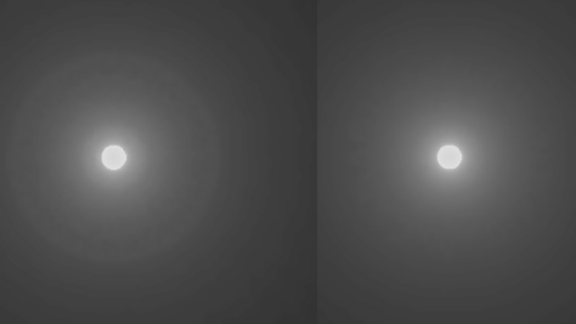
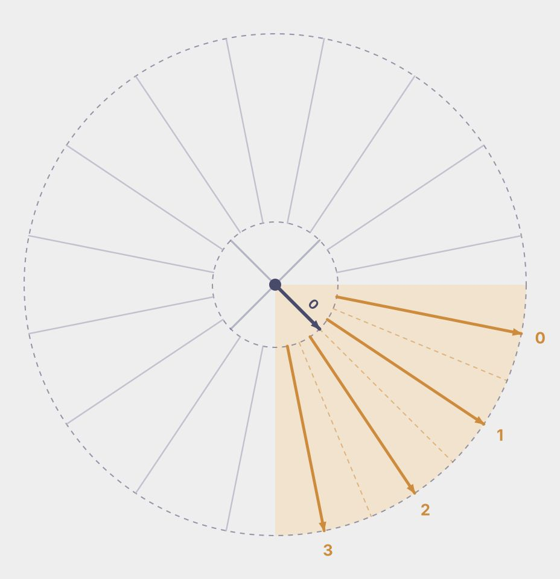
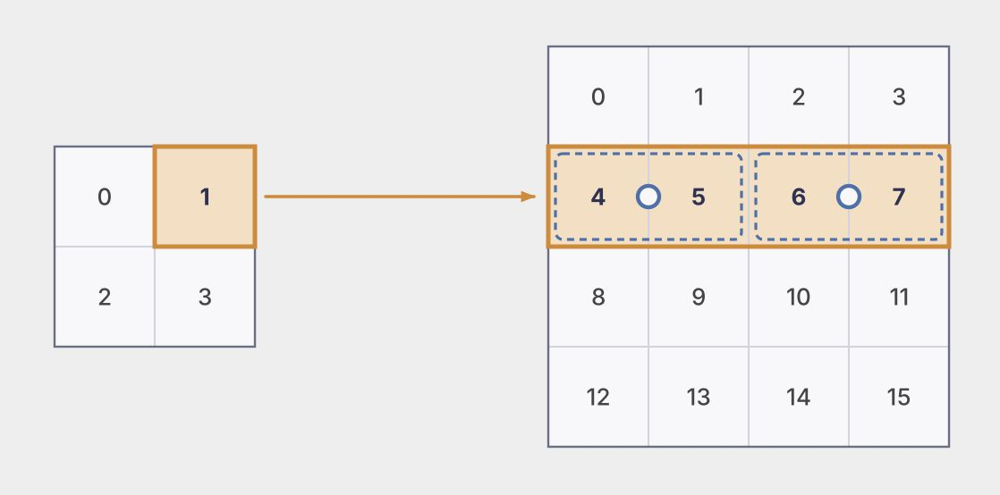
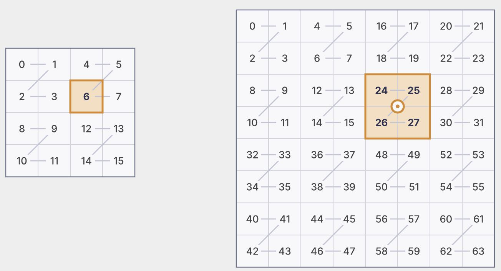

##### *This post assumes you generally know how Radiance Cascades works. If you don't, I recommend reading this [article by Max](https://m4xc.dev/articles/fundamental-rc/).*

In Radiance Cascades every ray in a cascade only covers its own interval. To get the light from further away, it merges with the cascade above. It finds the 4 nearest probes and then for each: averages the 4 directions that are inside the cone of the direction. Those 4 averages are then blended together based on distance, then the merge does two things: The ray's radiance becomes the ray’s own radiance plus the radiance from the cascade above, multiplied by the ray’s visibility. The visibility becomes the ray’s visibility multiplied by the one from above. When the visibility is 1 it means the ray hit nothing, if it is 0 it means it hit something, so once a ray hits, nothing after it matters anymore.


```cpp
float4 merge(float4 n, float4 n1) {
    const float3 radiance = n.rgb + (n1.rgb * n.a);
    return float4(radiance, n.a * n1.a);
}
```


There is a problem, though. The probes in the cascade above are spaced differently, so their intervals won't start where the ray ends. The ray ends at `p + w * t_{N + 1}`, but the rays you merge with start at `q_k + w * t_{N + 1}`, slightly next to it. The ray jumps sideways between cascades, which leads to artifacts (ringing, leakage).



A fix for this is the 'bilinear fix', it is described [here](https://academic.oup.com/rasti/article/doi/10.1093/rasti/rzae062/7929002#509497782) in an appendix in Osborne and Sannikov's paper. The bilinear fix makes it so instead of tracing 1 ray you trace 4 rays that go directly to the next starting point. Because we can't average the visibility (it would take the radiance from all 4 and not know which specific ray hit) and we also don't want to store the 4 of the rays we must combine our gathering and merging passes together.


```cpp
float4 merged = float4(0.0);
for (int i = 0; i < 4; i++) {
  float2 pos = ...;

  // from start to start of neighbours
  float4 result = trace(...);

  // from intervals from neighbour probe in upper cacsade
  float4 radiance = ...;

  merged += merge(result, radiance) * weights[i];
}
```


All this makes it so that the rays become continuous and will have less errors, leading to less artifacts. Obviously, this comes at a cost: 4x the amount of rays, which means 4x the amount of texture samples. You will be doing 16 texture samples per pixel per cascades pass (except the last cascade as there is nothing to merge with). This post is about getting that down to **4**.

### Bilinear sampling
Probes are stored as tiles in a texture, each texel in the tile is a direction. They are stored in row-major, so `dir_index = interval.y * probe_size + interval.x`. This places the 4 child intervals of a neighbour in a 1x4 strip. You might already be thinking: we can bilinearly sample here! A bilinear sample covers a 2x2 of texels, so our strip needs just 2 samples, which would bring it to 8 samples in total. This is already quite an improvement as the GPU handles the bilinear math for free in dedicated hardware. But we can do better...



### A New Order
Every direction has two things: a number, which decides its angle, and a texel in the probe’s tile, which decides where it’s stored. We can't change the numbers, a direction’s 4 children in the cascade above are always going to be `4d`, `4d+1`, `4d+2` and `4d+3`. What we can change is which texel each number goes into. We want to get it in one bilinear sample, so the 4 child directions need to be in a 2x2 block, and to find it without some lookup, it needs to sit right underneath where the parent is sitting: `2 * p + (i & 1, i >> 1)`. Apply this to every cascade from top to bottom (..., 8x8 to 4x4, 4x4 to 2x2) and you get the **Morton order** layout (a.k.a. Z-order curve).

It numbers each tile by splitting it into 4 quadrants:
<br>
`0 1`
<br>
`2 3`
<br>
Then it splits those quadrants into 4 again, the same way, again and again until the pieces are single texels. To compute this numbering, we need to know which quadrant the texel is in for each split. Each split needs to answer 2 questions: is it in the right half, and is it in the bottom half?

The answers to these questions are written in the texel's x and y in binary. Take an 8 wide tile, x will go from 0 to 7, which takes 3 bits, worth 1, 2, and 4 respectively. So if the third bit is set it is 4 or more, meaning its on the right half. Then if the second bit is set its `4+2=6` or more, meaning its on the right half of that right half. And then finally if the first bit is set then its `4+2+1=7`, meaning its the most right piece. The bits for y will answer it in the same way for the vertical halves. 



For the texel at (5, 3) it would be `01 10 11`, which if you put them together is 27. Thats this texel's index. In code thats taking bit i of x and bit i of y and putting them next to each other:


```cpp
uint interval_to_dir(uint2 t) {
  uint index = 0;
  for (uint i = 0; i < 16; i++) {
      index |= ((t.x >> i) & 1) << (2 * i);
      index |= ((t.y >> i) & 1) << (2 * i + 1);
  }
  return index;
}
```

My shader does the same without a loop. It spreads the bits of x apart so there’s a gap after each one using masks, and then using a shift and an OR it fills the gaps with the bits of y. fgiesen explains this [here](https://fgiesen.wordpress.com/2009/12/13/decoding-morton-codes/).


So now if we sample at `2 * interval + 1` we will be sampling at the corner the 4 children share. The weights will all be 0.25 and thus it calculates the average in one sample, four per pixel in a cascades pass.

### Results
It has its limits, for example the tiles must be a multiple of 2 and with 32 bit integers you can have up to 16 splits. But this shouldn't be a problem for most. In my renderer this reduced the cascades pass' time by ~2ms on a 1024x1024 scene with 6 cascades on my RTX 3070. It costs an extra sampler and a small index function, but you only need a quarter of your reads. 
