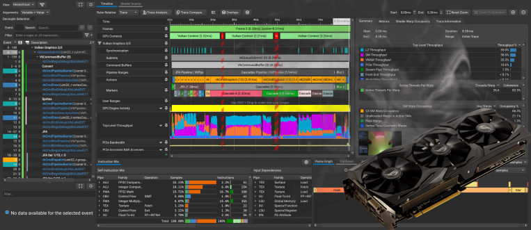

GPU profiling is very important for a graphics programmer, but how do you do it? What do you look for? What does it tell you? Surprisingly when I had these questions I could find very little information about it online. Outside vendor documentation or full books like *Programming Massively Parallel Processors (David Kirk, Wen-mei Hwu)*, I found little to no short and practical articles/guides on GPU profiling. So, I spent some time looking into it and in this post I will share what I learned while working on a real case. Whether this post is a short practical guide or if I've made the problem worse, is up to you.

### A different kind of processing
Your shader code can be correct but still be slow, for reasons that don't exist on the CPU. On a CPU you speed up code by doing less work: fewer instructions, a better algorithm, more cache friendly data. On a GPU speed also depends on: how threads are grouped, where the data is stored, and whether neighbouring threads take the same code path. All without changing the amount of work that needs to be done.

To understand these reasons we first need to look at how these processors are built. A CPU core is built to make one thread really fast. It has a high clock speed, big caches, branch prediction, etc. A GPU *core*, on its own, is a lot simpler and slower, but there are thousands of them working at once.

#### The architecture and inner workings
So how does your code run on all these *cores*? A shader runs once per item of work, that could be per vertex, per pixel, or per thread you dispatch. Each shader invocation runs on its own piece of data, a fullscreen pass over a 1080p image would have about 2 million of them. Each shader invocation is a thread, and the cores that I mentioned before are actually lanes: small execution units that run the instructions. The GPU assigns threads to these lanes whenever it can. So, those 2 million threads don't run all at once but will assign as much as it can and then assign more when those finish.

For vertex and fragment shaders the GPU decides how the work is distributed. In a compute shader you decide by specifying how many *workgroups* you want and their size. A workgroup is a block of threads with a fixed size that you set in the shader in one, two or three dimensions (i.e. 8x8 is a block of 64 threads). When dispatching you similarly specify how many workgroups you want (i.e. 128x128 will run 16384 workgroups, 16384 workgroups of 8x8 (64) threads would cover a 1024x1024 image exactly).

This grouping isn't for nothing. A workgroup always runs together on one part of the GPU, this allows its threads to share memory and wait on each other. Other workgroups are independent, they can run in any order and can't wait on each other. Since compute shaders give most control over how work is distributed and because my real case uses them a lot, I will mostly cover compute shaders here from now on. However, many of the concepts I will discuss will still apply to other types of shaders too.

The GPU doesn't run these threads one by one though. It runs them in fixed groups of 32, NVIDIA calls them warps and AMD calls them waves (I will mostly be using NVIDIA's terminology). All 32 threads in a warp execute the same instruction at the same time in a SIMD style lockstep.

Once a workgroup is assigned to an SM, its warps will stay there until they finish. These warps are called resident warps.

Warps run on streaming multiprocessors, a.k.a. SMs (Compute Units (CUs) or Workgroup Processors (WGPs) on AMD). Each SM has four schedulers and each one picks a resident warp that is ready to be executed. When memory is requested from VRAM it can take hundreds of cycles, the wait is called latency. To combat this latency we have caches: each SM has an L1 cache and all SMs together share an L2 cache. However, this does not eliminate the wait. So, the schedulers have a little trick for this called latency hiding: they will switch to another resident warp that already has its data ready. This only works if an SM has enough resident warps at hand.

How many warps an SM holds, out of its maximum (depends on your GPU), is called occupancy. It is controlled by a couple of factors: how many registers, a workgroup slot, and how much shared memory.

#### A GPU in numbers
To give a bit of perspective I will tell you what my GPU, an **RTX 3070**, has:
 
- **Each SM:** 4 sub-partitions, each with its own scheduler, a quarter of the registers, FP32/INT32 execution units and a tensor core. The RT core and the L1/texture/shared memory belong to the entire SM
- **Total SMs:** 46.
- **FP32 Lanes per SM:** 128. 32 per sub-partition. 16 of those 32 can do only float math and the other can do both float and integer math.
- **Resident Warps per SM:** 48. 12 per sub-partition. 1536 threads. Used for calculating occupancy.
- **Workgroups per SM:** 16. No matter the size.
- **Registers per SM**: 65536 * 32 bits. 16384 per sub-partition. A thread's registers stay on the SM for as long as it is resident, this allows the switching.
- **Registers per thread:** up to 255. They are allocated per warp in blocks of 256, so thats 8 per thread. Meaning they are rounded up to multiples of 8, so 41 registers is actually 48. The 256th is the zero register and is used to read 0 or discard writes.
- **Shared Memory per SM:** 100KB.
- **VRAM:** 8GB of GDDR6.

#### Occupancy
The occupancy is decided by whichever limit runs out first. Take a workgroup with 256 threads, 64 registers, and 12KB of shared memory. On my 3070 that gives:
 
- **Threads:** an SM holds 1536 threads, so `1536/256 = 6` workgroups.
- **Registers:** each workgroup needs `64 * 256 = 16384` registers, and an SM has 65536, so `65536 / 16384 = 4` workgroups.
- **Shared Memory:** an SM has 100KB, so `100 / 12 = 8.33..`, rounded down to 8 workgroups.

So the registers are the bottleneck here and you will only fit 4 workgroups.

The workgroup size you pick can also be the limit. Take a workgroup of 64 threads. The thread limit would allow `1536 / 64 = 24` of them, but an SM can have only 16 workgroups, so it will be 16. That's 16 workgroups of `64 / 32 = 2` warps each, so `16 x 2 = 32` warps, 67% occupancy. Make it 128 threads and its `1536 / 128 = 12` workgroups, which does fit within the 16, and the SM reaches 48 warps (max).

Making the workgroup size too big can be bad as well. A workgroup of 1024 threads fits only once, so the SM again sits at 32 out of 48 warps.

It can be important to keep occupancy high, the more workgroups you have, the more resident warps you have, the more it can hide latency. It is however not always as important. A pass limited by math will not get faster with more occupancy.

#### Divergence
Warps get executed in a lockstep (SIMT). A warp issues one instruction for all 32 threads. When a thread takes a different branch from the rest, it will first run that path, while masking off threads that took another branch for the remaining instructions. It will then run the remaining paths with the other paths masked off. Keep in mind, loops are branches too. A loop whose condition depends on the data will keep the warp busy until the loop with the most iterations is done.

To combat divergence you can try to make the threads in a warp take the same path, for example by grouping similar work together or replacing a branch with math that every thread can do. Divergence can’t always be avoided though, so keep the work inside these branches cheap and move anything expensive, like memory operations, outside where the whole warp is back together and can do it at once.

### Profiling in practice
Now that we have all that technical knowledge we can actually start profiling! First we must measure, never blindly try and optimize your code. To keep numbers comparable make sure that you are comparing between the same scene, across many frames, and with only one change to keep it targeted.

Before you look towards your shaders, make sure that your GPU is the bottleneck. If the CPU is taking longer to prepare a frame than the GPU takes to execute it, the GPU will sit idle and no changes to your shaders will make it run any faster. Compare your total frame time with the time the GPU spends. If they are close, then you are GPU bottlenecked and you can continue.

Now we need to look at where our frame time on the GPU goes. We will do this in two ways. Timestamps, written by the application itself around every pass, which will tell us where the time goes in a frame. And a profiler, which will tell us why these things take the time that they do. I will be using Nsight Graphics, NVIDIA's profiler, so the profiler part of this post is specifically for NVIDIA. AMD has their own profiler, Radeon GPU Profiler, which I haven't used. The timestamps work the same on any GPU.

I also recommend adding debug labels, they give each pass, and possibly more (i.e. each dispatch), a name that will show up in RenderDoc and in your profiler of choice.

#### What to trust
Both the timings you get from your timestamps and the timings you get from your profiler will not be 100% true. They answer different questions and so there are separate cases for each. Timestamps can tell you the GPUs clock right before and right after each pass, subtracting that from each other gives you the duration. The profiler will tell you what the GPU did and how long it took.

Timestamps will tell you the timings under normal circumstances (boosted clock speeds and no profiler attached), the way the viewer will experience it. However, timestamps aren't exactly written when the work of a pass begins or ends. The begin timestamp is written as soon as the GPU reaches it, possibly before all the work from the previous pass has finished. The end timestamp waits until all work is finished. So a pass's duration can include some amount of time from work from a previous pass. 

The profiler will show you every dispatch on the GPU's timeline, including overlap, so you see exactly when work begins and ends. It can hold clocks at a fixed speed and it tells you why the work takes time. But the profiler isn't exactly honest either. Your app will run under a profiler. With clocks fixed and counters being collected, passes will usually take longer than they do normally. It should be used to compare and find causes, not for the how the viewer will experience it.

I suggest using the timestamps as your headline before and after numbers and the profiler for the explanation.

#### Finding the limiter
Once you know what pass or specific dispatch is slow you can start looking into the cause. What is hitting its limit here? The profiler will show you how busy each part of the GPU was while it ran (math units, L1, L2, VRAM. etc.).

If they are close to their maximum, they cannot do any more work, meaning its throughput bound. The only way to improve this is by giving it less work: less things to process, fewer memory fetches, less math, etc.

If they aren't close to their maximum, it is latency bound: the warps spent most of their time waiting instead of doing actual work. The profiler will give you the reasons why these warps are stalling: data from memory, result of an earlier instruction, a barrier. To fix this you can either give the SM more warps to switch to or giving the warps less reasons to stall (i.e. less memory fetches).

Also something to watch out for is divergence. All the active threads could be perfectly busy with work, but it could be possible that due to divergence that some threads are masked off. So make sure to always check how many threads per warp are active.

#### The real case
For the real case I will be using my [radiance cascades project](../projects/radiancecascades) which lead me to all this GPU profiling. It implements 2D global illumination using multiple layers of probe grids. Specifically we will be looking at the 'Cascades' pass, with certain settings its: 6 dispatches that each go over a 2048x2048 image, where each thread traces 4 rays (in up to 64 steps) through a distance field. In a busy scene it took about 9ms out of the 12ms frame, while other passes were cheap in comparison, so it was the obvious target.

In the summary it showed that there was an overall low throughput, meaning it was waiting a lot. The stall reasons mainly pointed towards "Long Scoreboard", a.k.a. it was waiting a lot on memory. There were a couple hotspots it identified in the shader code. One of them was a texture load that happened within a nested for loop. It was looping over 4 probes which then each looped 4 times again over each texel that it needed to load. This meant it was waiting on 16 texture loads per shader invocation. The inner loop did not need the 4 texels on their own, it just needed an average. GPUs have specific hardware for this, they can bilinearly filter a 2x2 area of texels. So, instead of loading 4 pixels and averaging them, we sample once, exactly in the middle of that 2x2, and the hardware does it for us. There was a catch though, the texels I wanted to average were in 1x4 blocks, not 2x2. To solve this I used a morton order layout trick that I shared in [this post](../pages/bilinear).

One of the other spots where it was waiting on memory was inside the sphere tracing loop, inside a branch whenever it hit something. This made the divergence worse, because now the other threads had to wait before they could run their masked path. I moved the memory load outside of this loop, storing just if it hit and the hit location in the loop, and it saw the active threads per warp increase slightly. 

The summary also showed I had an achieved occupancy of ~50%. This is a bit low. In the shader pipelines it showed that for my cascades shader pipeline it only had 32 warps, out of theoretical 48. I wasn't using a crazy amount of registers, I wasn't using any shared memory, but I did have workgroups with only 64 threads (8x8). This meant that we had 2 warps per workgroup and that needs 24 workgroups to get the full 48 warps, but of course the limit is 16, so it could only run at 32 warps. To fix this I increased the workgroup size to 128 threads (16x8). This allowed 4 warps per workgroup and thus 12 workgroups, below the limit of 16, would suffice for 48 warps.

These optimizations resulted in:

| Version         | Cascades ms |
|-----------------|-------------|
| Before          | 9.16        |
| Morton layout   | 7.26        |
| Loop Divergence | 7.01        |
| Occupancy       | 6.59        |

### Conclusion
GPUs and CPUs are both powerful processors but each for different reasons. GPUs can run the same code at different speeds depending on how threads are grouped, where data lives, whether the threads inside a warp all take the same path or not, and more. Once you understand the architecture and its inner workings, you start understanding what the profiler is telling you.

Using the profiler with a methodical approach will, hopefully, lead you to improving your frame time and actually knowing why!
